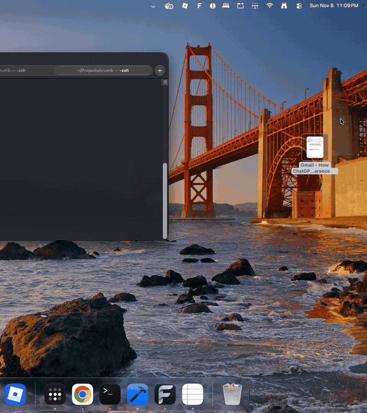

# Crumb

A little 3D puppy that lives at the bottom of your Mac's screen and keeps your Desktop tidy.

<p align="center"></p>

- **Tidies:** when a gap opens between your Desktop icons, Crumb walks over, picks the icon up in its mouth and
  carries it into place. It can also keep the Desktop sorted by name, kind or date.
- **Eats junk, but only if you say yes:** old screenshots, installers you've already installed, duplicate copies,
  unfinished downloads and temp files. It asks first ("Yum / Keep / Never ask about …"), at most once every
  15 minutes.
- **Nothing is lost:** an eaten file sits in Crumb's belly for 15 minutes, then goes to the Trash. Until you empty the
  Trash, **Belly ▸ Spit out** puts it back exactly where it was.
- **Sleeps:** when its belly is full (5 files), when you choose **Nap for 1h**, or after 10 quiet minutes.
- **Stays out of the way:** it never asks anything while a full-screen app is in front.

Click the puppy for its menu: Clean up now, Belly, Sort by, Nap for 1h, Settings and Quit.

## Install

Paste this into Terminal:

```sh
curl -fsSL https://raw.githubusercontent.com/Harshavardhan-Yaddalapuri/crumb/master/install.sh | bash
```

It downloads the latest release into **Applications** and starts Crumb. Run it again later to update. When macOS asks
whether Crumb may control **Finder**, click **Allow**: Crumb moves icons by asking Finder to do it.

Crumb has no Dock icon. To quit, click the puppy and choose **Quit Crumb**.

**Needs:** macOS 15 or later, on Apple Silicon or Intel.

### Uninstall

```sh
curl -fsSL https://raw.githubusercontent.com/Harshavardhan-Yaddalapuri/crumb/master/install.sh | bash -s -- uninstall
```

This quits Crumb and removes the app, its data and settings, and its Finder permission. Any files still in its belly
go to the Trash first, so nothing is lost.

### Manual install

Download `Crumb.zip` from [Releases](../../releases), unzip it and drag **Crumb.app** into Applications. Crumb isn't
signed with an Apple Developer ID yet, so the first time macOS says it can't verify the app: open **System Settings ▸
Privacy & Security** and click **Open Anyway** next to Crumb.

## Privacy and permissions

Crumb asks for one permission only: **Automation for Finder**, which lets it read where your Desktop icons are and
move them. It doesn't need Screen Recording, Accessibility or Full Disk Access, and it never connects to the network.
It only looks at your Desktop folder.

Eaten files wait in `~/Library/Application Support/Crumb/Belly` until they go to the Trash.

Crumb is built with Apple's **Hardened Runtime**, so other software on your Mac can't inject code into it to borrow
its Finder permission. Its only exception is sending Apple Events to Finder. File names travel to Finder as data,
never as script text, so a strangely named file can't run commands. The installer downloads over HTTPS only and
refuses a zip whose app is tampered with, isn't Crumb, or isn't hardened.

## Good to know

- Crumb works with Finder's standard Desktop icon size and spacing (View ▸ Show View Options: icon size 64, grid
  spacing in the middle, text size 12, labels at the bottom). With other settings it tells you and leaves the icons
  alone.
- If Finder's own **View ▸ Sort By** is on, Crumb asks you to set it to **None** so it can arrange the icons itself.
- Files with a Finder tag are never asked about.
- It only uses the main display.

## Build from source

Needs Xcode 16 or later.

```sh
swift test                      # run the tests
scripts/make-app.sh             # debug build: build/Crumb.app
open build/Crumb.app
scripts/make-app.sh release     # universal build plus build/Crumb.zip to attach to a GitHub release
```

Each rebuild changes the app's signature, so macOS asks for Finder permission again.

The project layout:

| Path | What's there |
|---|---|
| `Sources/CrumbCore` | Pure logic with tests: the icon grid, gap and sort planning, junk rules, the belly ledger, walking and poses |
| `Sources/Crumb` | The app: the overlay window and 3D puppy, Finder automation, tidying, eating and menus |
| `art/` | The puppy model (`crumb.usdz`) and the Blender script that builds it |
| `install.sh` | The one-line installer and uninstaller |
| `docs/` | The design spec, the implementation plans and the demo GIF |
| `spike/` | The early experiment that showed Finder icon moves are reliable |
